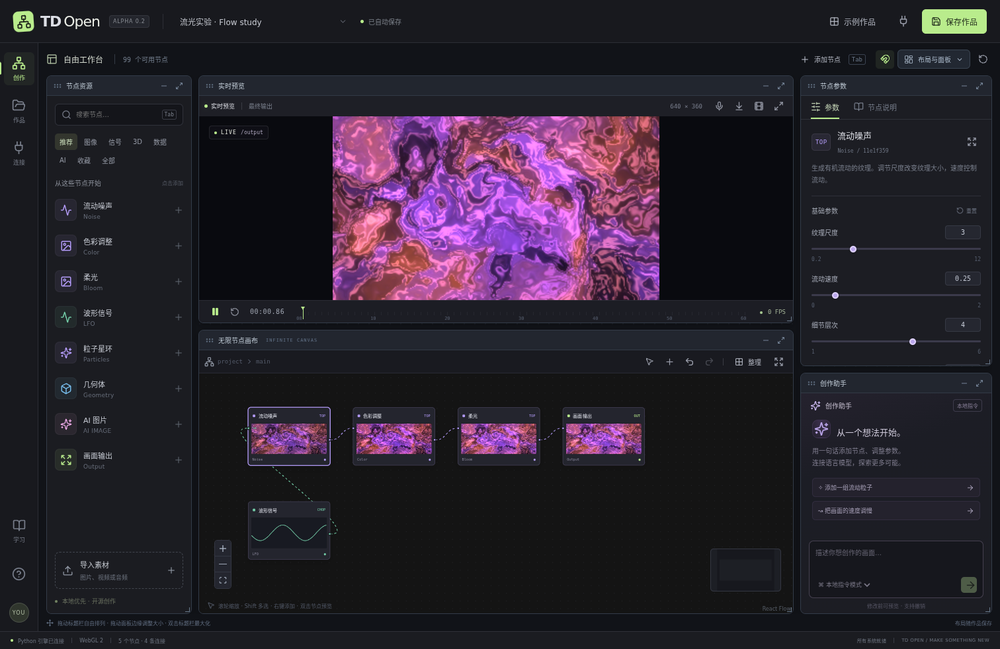

# TD Open

一个以中文新手体验为起点的开源节点创作工作台：连接节点、实时调整画面，把 AI 服务和 MCP 工具接入同一张创作图。

**当前为可运行的 0.2 Alpha，尚未实现 TouchDesigner 全功能等价。** 这是独立实现的项目，与 Derivative 无隶属关系，不包含其程序、图标或源码，也不兼容 `.toe` / `.tox`。详细支持范围和未完成项见 [功能矩阵](docs/FEATURE_MATRIX.md)。



## 现在可以做什么

- 自由排列五个独立面板：节点资源、实时预览、节点画布、参数、创作助手；拖动标题栏移动、拖动八个边缘/角点缩放，支持隐藏、最大化、网格吸附和布局保存。
- 在无限节点画布上添加、移动、框选、多选复制、删除、连接节点；复制多选节点时保留内部连线，支持撤销、重做和整理布局。
- 使用 **99 个内置节点**：新增 38 个图像节点、20 个信号节点、8 个数据节点、10 个几何节点。覆盖万花筒、反馈拖影、置换、遮罩、像素化、平滑、触发、积分、JSON/CSV、几何变换与合并等。完整列表见 [节点手册](docs/NODES.md)。
- 通过中文/英文快捷搜索添加节点、收藏常用节点，并自动连接选中节点的兼容输出。
- 使用 LFO、常量和数学节点驱动参数；导入音频或授权麦克风后，让频谱和粒子跟随声音。音频导入后可保存 URL 并手动重新播放。
- 通过 WebGL / Three.js 渲染几何体，以及符合条件的 glTF / GLB 生成资源。
- 保存作品、自动保存、导入 JSON；导出 PNG 和无音轨 WebM 录像，导出文件保留在本地 `data/exports`。
- 配置 OpenAI 兼容的文本/图片服务；通过自定义 HTTP 模板连接音乐、3D 和其他生成服务。实际请求仅在手动运行时发送。
- 在助手中预览并应用图编辑指令。未配置模型时使用明确标注的本地中文/英文指令解析器；连接语言模型后可让模型提出结构化图编辑。
- 连接 Streamable HTTP MCP 服务、发现和调用工具；也可将 TD Open 作为 stdio MCP 工具提供给外部 AI。编辑器在没有本地未保存修改时轮询同步外部项目更改。
- 用 Python 编写后端节点插件；代码里附带独立的 `python_scale` 示例。后端插件不会自动获得浏览器实时渲染能力。

## 在这台机器启动

环境、依赖和构建产物已放在 `/storage/homes/hongzj/dell/td_open`。

```bash
cd /storage/homes/hongzj/dell/td_open
./scripts/start.sh
```

在**运行服务的这台机器**打开 **http://127.0.0.1:8765**。如果通过 SSH 操作远端机器，可在自己的电脑建立端口转发：

```bash
ssh -L 8765:127.0.0.1:8765 用户名@服务器地址
```

之后在自己电脑访问同一地址。浏览器需支持 WebGL 2；麦克风需要浏览器授权与安全上下文。默认仅绑定本机，当前版本没有多人身份认证。

## 在另一台机器安装

需要 Python 3.11+、Node.js 20.19+（建议 Node 22）、npm。当前安装脚本面向 Linux / macOS Bash。

```bash
./scripts/setup.sh
./scripts/start.sh
```

前端改动后重新构建：

```bash
# 本项目目录中已提供 Node 22；如使用系统 Node 22，可以省略这行
export PATH="$PWD/.tools/node-v22.21.1-linux-x64/bin:$PATH"
cd frontend
npm run build
```

开发时分别运行 Python 后端和 `frontend` 内的 `npm run dev`。开发界面使用 `http://127.0.0.1:5178`，API 通过 Vite 转发到后端。

## 第一个作品

1. 点击“示例作品”，选择“流光实验”；它不需要任何 AI API。
2. 点击“流动噪声”，在右侧调整尺度和速度。双击节点可预览中间画面。
3. 从左侧添加节点，拖动左右两端的圆点连线。图像连接到图像，数值连接到调制端口。
4. 点击保存。预览栏的下载图标保存 PNG；录像按钮开始/停止保存 WebM。

快捷键：画布内 `Tab` 或 `Ctrl/Cmd+K` 打开节点搜索，`Space` 暂停/播放，`Ctrl/Cmd+S` 保存，`Ctrl/Cmd+Z` 撤销，`Ctrl/Cmd+Shift+Z` 重做，`Ctrl/Cmd+D` 复制选中节点（含内部连线）。按住 `Ctrl/Cmd` 点击多选；按住 `Shift` 拖动框选，或切换画布工具栏的框选模式。

面板使用：拖动标题栏自由移动，拖动边缘或角点调整大小；双击标题栏最大化，按 `Esc` 还原。右上角“布局与面板”提供标准、画布优先、视觉优先三种布局，以及隐藏面板的恢复入口。布局按作品保存；窄屏自动改为纵向滚动。拖动不会改变作品节点的坐标。可查看 [画布优先布局截图](docs/images/studio-canvas-layout.png)。

“示例作品”可直接打开新增的三个范例。`examples/` 内提供 8 份可导入作品，其中 `kaleidoscope.tdopen.json` 展示万花筒与反馈，`geometry-lab.tdopen.json` 展示几何变换与合并，`data-driven.tdopen.json` 展示 CSV 数据驱动画面。

## AI / MCP

点击“连接”添加服务。API 密钥只写入后端的私密配置文件，不写入作品 JSON。重新编辑服务时，密钥留空保留已有值。连接真实付费服务后，生成请求按服务商规则计费；本项目不内置密钥。

音乐与 3D 没有统一 API，因此此版本提供可配置的 HTTP 请求体模板。同步返回的资源地址会进入节点；异步服务会返回任务信息，**尚未实现通用自动轮询、回调或所有供应商专用适配器**。

MCP 客户端示例配置（请把路径替换为自己的安装目录）：

```json
{
  "mcpServers": {
    "td-open": {
      "command": "/storage/homes/hongzj/dell/td_open/.venv/bin/python",
      "args": ["-m", "backend.mcp_server"],
      "cwd": "/storage/homes/hongzj/dell/td_open",
      "env": {"TD_OPEN_APP_URL": "http://127.0.0.1:8765"}
    }
  }
}
```

先启动 Python 应用。支持的图工具、接口、供应商模板和安全边界见 [AI 与 MCP 接入指南](docs/AI_API.md)。

## 所有文件放在哪里

| 目录 | 内容 |
| --- | --- |
| `frontend/src` | TypeScript 界面、算子定义、实时渲染引擎 |
| `backend` | Python API、持久化、图校验、AI/MCP 接入 |
| `backend/plugins` | Python 节点扩展和示例 |
| `data/projects` | 作品 JSON |
| `data/assets` | 导入素材与服务直接返回的 base64 媒体 |
| `data/config` | 服务配置与密钥，文件权限限制且 Git 忽略 |
| `data/exports` | PNG、WebM、JSON 导出文件 |
| `data/artifacts` | 验证报告与界面截图 |
| `examples` | 可导入的示例作品 JSON |
| `.tools`、`.venv`、`.cache` | 本项目工具、虚拟环境、依赖缓存和隔离测试数据 |

默认所有服务端写入均留在该项目目录。供应商仅返回远程链接时，远程资源仍由供应商托管；它不会被自动批量下载。远程图像/模型用于预览和导出时需要服务允许跨域。独立 `.gltf` 的外部纹理/二进制资源也需要可访问，推荐使用自包含 GLB。

使用 `TD_DATA_DIR=.cache/demo-data ./scripts/start.sh` 可以创建隔离数据目录；该目录必须位于项目根目录内。不要提交 `data/config`、私人素材或密钥。准备开源时只提交源代码、依赖锁和公开示例。

## 扩展与验证

项目校验、后端信号求值、服务接入与存储使用 Python，交互和实时图形使用 TypeScript，避免把每一帧图像通过 HTTP 往返传输。完整 GPU 纹理管线、嵌套组件、POP/MAT 全族、GLSL 编辑、OSC/MIDI/NDI/Spout/DMX、投影映射、专业编解码和原生桌面壳仍在路线图中。

- [架构与插件开发](docs/ARCHITECTURE.md)
- [功能对照矩阵](docs/FEATURE_MATRIX.md)
- [分阶段路线图](docs/ROADMAP.md)
- [贡献说明](CONTRIBUTING.md)
- [验证记录](docs/VALIDATION.md)

```bash
.venv/bin/python -m pytest
cd frontend
npm test
npm run build
```

浏览器端到端脚本为 `frontend/browser-e2e.mjs`，需要先启动隔离测试服务和 Chromium；通过 `TD_CHROMIUM` 指定浏览器可执行文件。脚本会创建测试作品及本地伪造的 API 服务配置，因此**不要针对私人生产数据运行**。测试不调用付费接口。

本项目源代码采用 [MIT License](LICENSE)。第三方依赖仍遵循各自许可证，见 [第三方依赖说明](THIRD_PARTY_NOTICES.md)。
