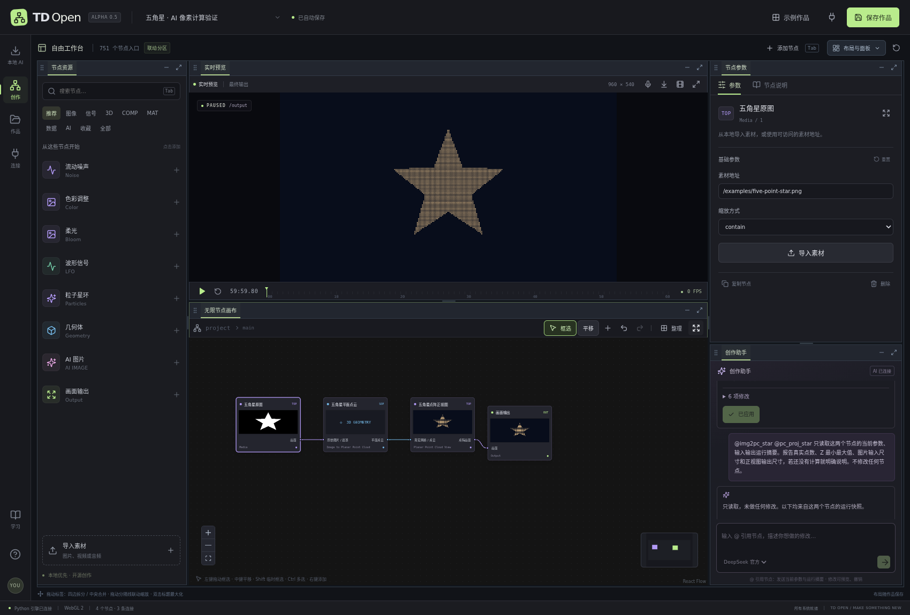
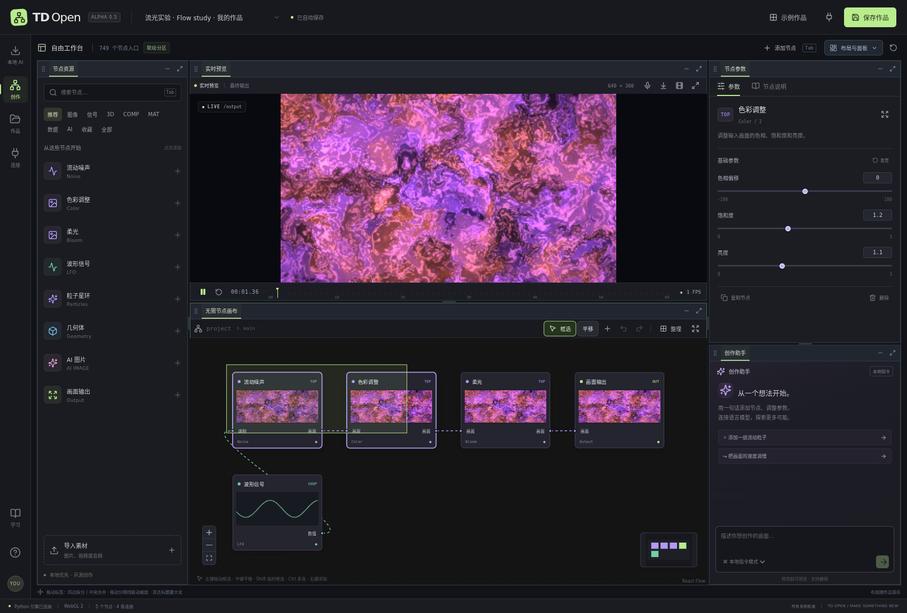
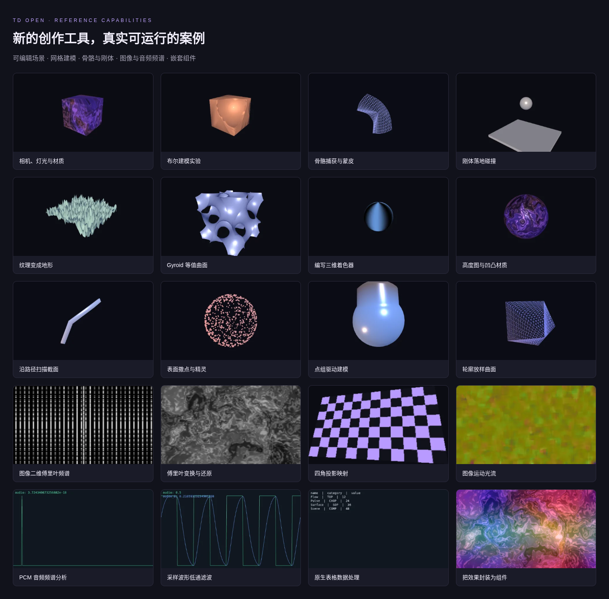
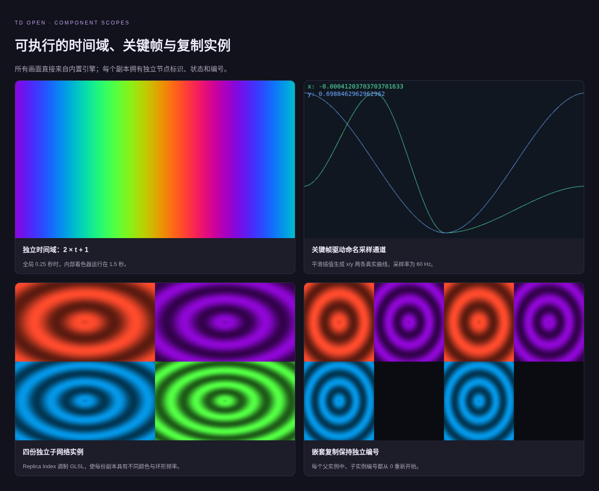
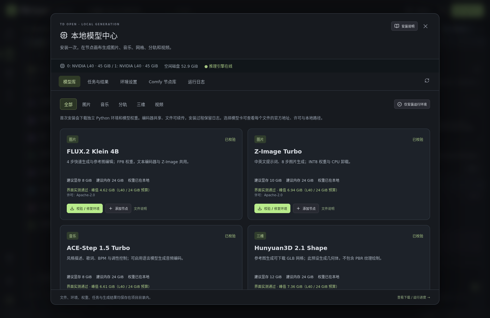
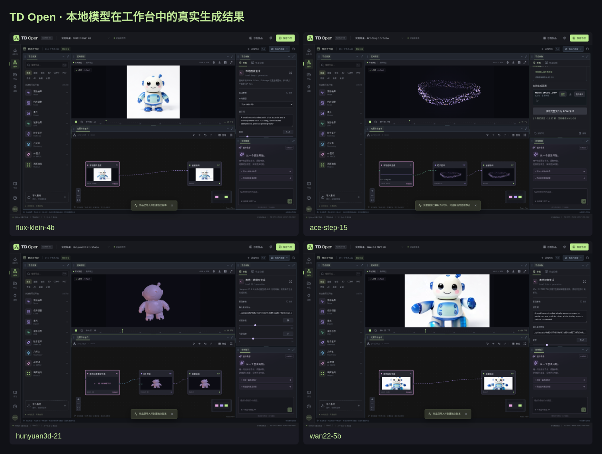
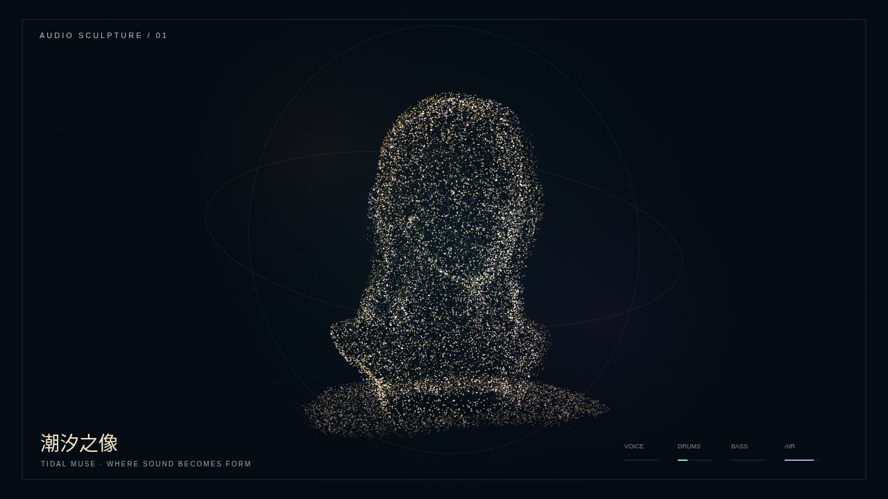
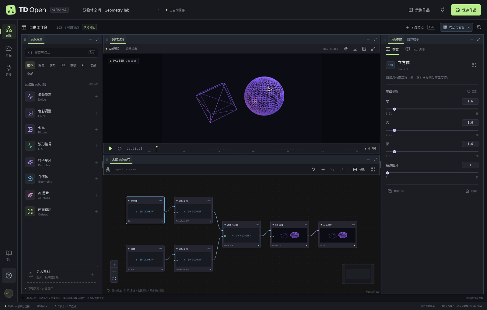
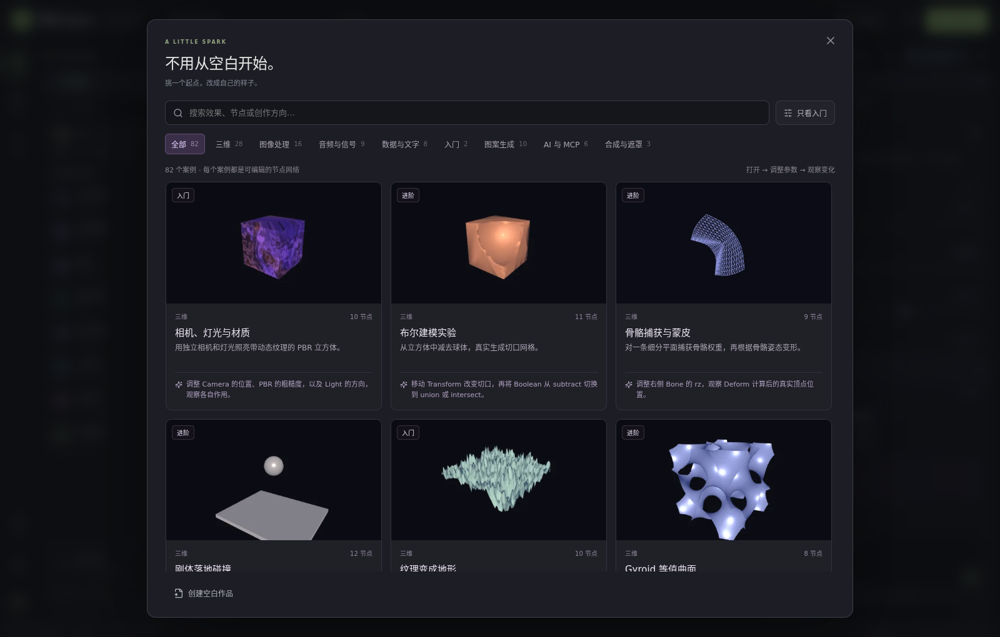
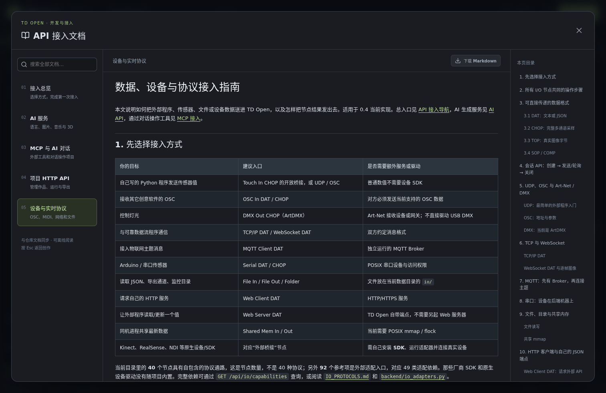

# TD Open

一个以中文新手体验为起点的开源节点创作工作台：连接节点、实时调整画面，把 AI 服务和 MCP 工具接入同一张创作图。

**751 个节点入口 · 96 个可编辑案例 · 联动停靠工作区 · Python + TypeScript · MIT**

创作助手支持 **`@节点` 读取参数、连线及实际输入输出摘要**。新增「星图 · 图片变成平面点云」：已有 PNG → 像素采样 → Z=0 点云 → 正视图，完全不调用生图或 3D 生成模型。[使用方法与实测结果](docs/AI_API.md#引用节点与图片转平面点云)




Open-source visual programming studio with a dockable workspace, real-time graphics, local AI models, AI APIs and MCP.

**当前为可运行的 0.5 Alpha，尚未实现 TouchDesigner 全功能等价。** 这是独立实现的项目，与 Derivative 无隶属关系，不包含其程序、图标或源码，也不兼容 `.toe` / `.tox`。对参考截图的 531 项逐项核对：432 项已有可运行子集、7 项由已有相关节点覆盖、92 项需要外部适配器。详细支持范围和未完成项见 [功能矩阵](docs/FEATURE_MATRIX.md)，可检索的 [逐项清单](docs/REFERENCE_COVERAGE.md) 保留每项限制。







上图均由项目内置引擎实际渲染。图库另有 AI / MCP 工作流，明确标注需连接服务，未填入虚构的生成结果。







[观看带声音的演出片段](docs/media/tidal-muse-preview.mp4) · [完整案例操作说明](docs/TIDAL_MUSE.md)：本地文生图 → 本地三维 → 28000 点表面点云；本地文生音乐 → Demucs 四轨 → 人声变色、鼓点跳动、贝斯呼吸、其他乐器波纹。可一键生成整件作品；预览区直接播放音乐、调整音量和查看输出电平，并可同步播放与导出带声音的演出。

## 现在可以做什么

- **类似 Blender 的联动停靠布局**：节点资源、实时预览、节点画布、参数、创作助手共用边界；拖动分隔线时相邻区域同步增减，支持上下/左右拆分、拖动合并标签、隐藏、最大化和按作品保存。
- 在无限节点画布上添加、移动、框选、多选复制、删除、连接节点；默认左键拖动空白处框选、中键平移，也可在工具栏明确切换“框选 / 平移”。复制多选节点时保留内部连线，支持撤销、重做和整理布局。
- **751 个节点入口**：TOP 206、CHOP 213、SOP 132、DAT 128、COMP 40、MAT 13、AI 18、OUT 1。包含 **92 个需要外部 SDK/硬件适配器的入口**，其余也按实际实现子集说明；数量不代表商业软件完整兼容。详见 [逐项对照](docs/REFERENCE_COVERAGE.md) 与 [节点手册](docs/NODES.md)。
- **本地 AI 与原生 ComfyUI**：45 个新增节点入口，支持 FLUX.2 Klein、Z-Image、ACE-Step 1.5、Hunyuan3D 2.1、MelBand、Demucs、Wan 2.2。提供独立环境、可续传权重下载、哈希校验、单卡显存预算、任务队列、取消、结果下载，以及原生 API 工作流导入和实际 Comfy 节点库。七组模型已通过工作界面实跑；[安装文档](docs/LOCAL_AI.md) / [真实运行与显存记录](docs/LOCAL_AI_VALIDATION.md)。
- **真正可编辑的组件内部网络**：双击进入 Base / Container / Time 等组件，通过 In/Out 与父级连接，使用绝对/相对节点引用；支持独立时钟和 Replicator 模板复制。
- **真实采样、网格和着色器**：命名多通道 CHOP、表格 DAT、音频 PCM/FFT/WAV、布尔/曲线/蒙皮 SOP、13 个 MAT、相机灯光与刚体场景、WebGL 2 GLSL。
- **Python、网页与协议**：手动运行 Python TOP/CHOP/SOP/DAT；Chromium 捕获网页；OSC、UDP/TCP、WebSocket、MQTT、Art-Net、串口、文件与共享内存；授权后使用 MIDI、摄像头、屏幕捕获和浏览器音频。
- **96 个代表性案例**：纹理与分形、图像处理、合成与遮罩、三维雕塑、音频与信号、文字数据、AI 与 MCP。支持搜索、分类、入门筛选；附真实缩略图和动手提示。另提供 1 份空白作品，全部可从 [案例索引](docs/EXAMPLES.md) 下载。
- 通过中文/英文快捷搜索添加节点、收藏常用节点，并自动连接选中节点的兼容输出。
- 使用 LFO、常量和数学节点驱动参数；导入音频或授权麦克风后，让频谱和粒子跟随声音。音频导入后可保存 URL 并手动重新播放。
- 通过 WebGL / Three.js 渲染几何体、材质与场景，以及可访问的 glTF / GLB / OBJ / FBX 资源。
- **案例原件保护**：打开案例不会覆盖原件；首次编辑自动创建自己的项目副本，后续编辑继续保存该副本。两个用户编辑同一案例使用独立 ID，HTTP / MCP 保存案例也会另存。
- **端口与连线**：端口名称直接显示在节点里，卡片随端口数量增高；整理布局会考虑实际高度，连线跟随端口重算。
- 保存作品、自动保存、导入 JSON；导出 PNG 和 WebM 录像（声景演出支持同步音轨），导出文件保留在本地 `data/exports`。
- 配置 OpenAI 兼容的文本/图片服务；通过自定义 HTTP 模板连接音乐、3D 和其他生成服务。实际请求仅在手动运行时发送。
- 在助手中预览并应用图编辑指令。未配置模型时使用明确标注的本地中文/英文指令解析器；连接语言模型后可让模型提出结构化图编辑。
- **DeepSeek 官方创作助手已实测**：真实对话、参数修改、重命名、节点创建与连接、撤销 / 重做和保存均通过；[配置与复现步骤](docs/AI_API.md#deepseek-官方已实测的创作助手连接) / [工作台实测截图](docs/images/deepseek-assistant-live.png)。
- 连接 Streamable HTTP MCP 服务、发现和调用工具；也可将 TD Open 作为 stdio MCP 工具提供给外部 AI。编辑器在没有本地未保存修改时轮询同步外部项目更改。
- 用 Python 编写后端节点插件；代码里附带独立的 `python_scale` 示例。后端插件不会自动获得浏览器实时渲染能力。

## 在这台机器启动

Windows 与 macOS 用户可以使用独立桌面安装包，无需先安装 Python 或 Node.js。见 [桌面版下载、安装、数据迁移和平台支持说明](docs/DESKTOP.md)；[安装包发布页](https://github.com/GreyNails/td-open/releases)。桌面版与网页版共享工作台、节点和工程格式；大型模型首次使用仍需下载，Mac 的本地模型兼容范围与 NVIDIA 环境有区别。

环境、依赖和构建产物已放在 `/storage/homes/hongzj/dell/td_open`。

```bash
cd /storage/homes/hongzj/dell/td_open
./scripts/start.sh
```

在**运行服务的这台机器**打开 **http://127.0.0.1:8765**。如果通过 SSH 操作远端机器，可在自己的电脑建立端口转发：

```bash
ssh -L 8765:127.0.0.1:8765 用户名@服务器地址
```

之后在自己电脑访问同一地址。浏览器需支持 WebGL 2；麦克风需要浏览器授权与安全上下文。默认仅绑定本机，当前版本没有多人身份认证。

## 在另一台机器安装

需要 Python 3.11+、Node.js 20.19+（建议 Node 22）、npm。当前安装脚本面向 Linux / macOS Bash。

```bash
git clone https://github.com/GreyNails/td-open.git
cd td-open
./scripts/setup.sh
./scripts/start.sh
```

前端改动后重新构建：

```bash
# 本项目目录中已提供 Node 22；如使用系统 Node 22，可以省略这行
export PATH="$PWD/.tools/node-v22.21.1-linux-x64/bin:$PATH"
cd frontend
npm run build
```

开发时分别运行 Python 后端和 `frontend` 内的 `npm run dev`。开发界面使用 `http://127.0.0.1:5178`，API 通过 Vite 转发到后端。

### 可选的网页渲染依赖

Web Render 需要 Chromium。安装文件同样保存在项目目录内：

```bash
export PLAYWRIGHT_BROWSERS_PATH="$PWD/.cache/ms-playwright"
cd frontend
npx playwright install chromium
```

启动脚本会设置项目内浏览器缓存路径，也可用 `TD_CHROMIUM=/path/to/chromium ./scripts/start.sh` 指定已有浏览器。Python Script 是手动运行的受信任本机代码，可使用当前用户的文件和网络权限，不是沙箱。

## 本地图片、音乐、三维、分轨和视频

这台机器已安装并校验七组模型。点击左侧 **本地 AI** 查看环境和权重，添加节点后填写提示词、上传输入素材，再点击 **运行本地工作流**。也可从 **示例作品 → 本地 AI** 开始。所有任务手动启动，结果保存到项目目录。

在其他机器上点击模型卡的 **一键安装**，或按 [详细手动安装与权重接入](docs/LOCAL_AI.md) 配置。公开仓库不包含权重；模型源码与权重各自保留原许可。本次使用单张 L40 强制 24 GiB 预算测试，七组预设显存峰值最高约 12.69 GiB；尚未在实体游戏显卡或 Windows 上复测，任意分辨率和时长需要另行验证。LTX-2.5 需要账户许可，未在本机授权和验收。

## 第一个作品

1. 点击“示例作品”，选择“流光实验”；它不需要任何 AI API。
2. 点击“流动噪声”，在右侧调整尺度和速度。双击普通节点预览中间画面，双击组件进入内部网络。
3. 从左侧添加节点，拖动左右两端的圆点连线。图像连接到图像，数值连接到调制端口。
4. 点击保存。预览栏的下载图标保存 PNG；录像按钮开始/停止保存 WebM。

快捷键：画布内 `Tab` 或 `Ctrl/Cmd+K` 打开节点搜索，`Space` 暂停/播放，`Ctrl/Cmd+S` 保存，`Ctrl/Cmd+Z` 撤销，`Ctrl/Cmd+Shift+Z` 重做，`Ctrl/Cmd+D` 复制选中节点（含内部连线）。按住 `Ctrl/Cmd` 点击多选；默认左键拖动空白处框选，中键平移；工具栏可切换“框选 / 平移”，`Shift` 可临时框选。

面板使用：

- 拖动面板标题标签到另一区域**中央**，将两者合并为标签页；拖到**四边**，创建相应方向的分栏。拖动时高亮显示落点范围。
- 拖动共用分隔线，相邻区域一增一减；双击分隔线均分（受最小尺寸约束）。选中分隔线后可用方向键调整，`Shift` 加速。
- 双击标题或点最大化按钮，`Esc` 还原。“布局与面板”提供标准、画布优先、视觉优先预设，以及隐藏面板的恢复入口。
- 布局、活动标签和隐藏状态随作品保存。旧 0.2 浮窗布局会迁移到对应平铺预设，保留隐藏状态；窄屏自动改为纵向滚动。



“示例作品”收录 96 个完整节点网络。无须密钥即可运行大多数程序图像、信号和三维案例；声音案例可导入音频或使用麦克风。AI / MCP 案例需要配置服务并手动执行；新增 13 个本地 AI 案例需要安装相应权重。



## AI / MCP

软件内点击 **“学习 → API 接入文档”**，或在 **“连接 → 接入指南”** 查看完整教程。文档支持全文搜索、章节目录、复制代码与下载原文，构建后可离线阅读。也可直接打开 [应用内接入总览](http://127.0.0.1:8765/#guide/start)。



| 文档 | 包含内容 |
| --- | --- |
| [接入总览](docs/API_GUIDE.md) | 选择接入方式、区分三种服务地址、第一次连接与配置保存位置 |
| [AI 生成服务](docs/AI_API.md) | 语言、图片、音乐、3D；每个字段怎么填、HTTP 模板、返回格式与错误排查 |
| [MCP 与 AI 对话](docs/MCP_GUIDE.md) | 连接外部 MCP 工具、工具权限、让外部 AI 操作 TD Open、预览与应用图修改 |
| [项目 HTTP API](docs/HTTP_API.md) | Python / curl 创建作品、连接节点、运行、上传素材、导出与脚本调用 |
| [设备与实时协议](docs/IO_GUIDE.md) | OSC、UDP/TCP、WebSocket、MQTT、Art-Net、MIDI、串口、文件与共享内存 |

第一次接 API 可以先运行 [无需密钥的本地演练](examples/api/README.md)。附带四份可直接保存的连接配置，返回文字、PNG、WAV 和 GLB 测试素材，帮助检查请求与节点流程；演练服务不是 AI 模型，不调用外部接口。

点击“连接”添加服务。API 密钥只写入后端的私密配置文件，不写入作品 JSON。重新编辑服务时，密钥留空保留已有值。连接真实付费服务后，生成请求按服务商规则计费；本项目不内置密钥。

音乐与 3D 没有统一 API，因此此版本提供可配置的 HTTP 请求体模板。同步返回的资源地址会进入节点；异步服务会返回任务信息，**尚未实现通用自动轮询、回调或所有供应商专用适配器**。

MCP 客户端示例配置（请把路径替换为自己的安装目录）：

```json
{
  "mcpServers": {
    "td-open": {
      "command": "/storage/homes/hongzj/dell/td_open/.venv/bin/python",
      "args": ["-m", "backend.mcp_server"],
      "cwd": "/storage/homes/hongzj/dell/td_open",
      "env": {"TD_OPEN_APP_URL": "http://127.0.0.1:8765"}
    }
  }
}
```

先启动 Python 应用。不同客户端的工作目录、SSH 配置、八个工具及完整对话步骤见 [MCP 接入指南](docs/MCP_GUIDE.md)。

## 所有文件放在哪里

| 目录 | 内容 |
| --- | --- |
| `frontend/src` | TypeScript 界面、算子定义、实时渲染引擎 |
| `backend` | Python API、持久化、图校验、AI/MCP 接入 |
| `backend/plugins` | Python 节点扩展和示例 |
| `data/projects` | 作品 JSON |
| `data/assets` | 导入素材与服务直接返回的 base64 媒体 |
| `data/config` | 服务配置与密钥，文件权限限制且 Git 忽略 |
| `data/exports` | PNG、WebM、WAV、JSON 导出文件 |
| `data/artifacts` | 验证报告与界面截图 |
| `examples` | 96 个案例 + 1 个空白项目 JSON |
| `examples/api` | API 演练服务、四份连接配置与 MCP 客户端配置模板 |
| `docs/*API*.md`、`docs/MCP_GUIDE.md`、`docs/IO_GUIDE.md` | 应用内文档中心共用的接入教程源码 |
| `frontend/public/examples` | 实际渲染的案例缩略图；AI 卡片明确显示连接说明 |
| `docs/images` | README 展示截图与渲染总览 |
| `.tools`、`.venv`、`.cache` | 本项目工具、虚拟环境、依赖缓存和隔离测试数据 |

默认所有服务端写入均留在该项目目录。供应商仅返回远程链接时，远程资源仍由供应商托管；它不会被自动批量下载。远程图像/模型用于预览和导出时需要服务允许跨域。独立 `.gltf` 的外部纹理/二进制资源也需要可访问，推荐使用自包含 GLB。

使用 `TD_DATA_DIR=.cache/demo-data ./scripts/start.sh` 可以创建隔离数据目录；该目录必须位于项目根目录内。不要提交 `data/config`、私人素材或密钥。公开仓库仅包含源代码、依赖锁、文档截图和公开示例。

## 扩展与验证

项目校验、后端信号求值、服务接入与存储使用 Python，交互和实时图形使用 TypeScript，避免把每一帧图像通过 HTTP 往返传输。完整 GPU 浮点纹理管线、POP、原生厂商驱动、专业音视频/同步、完整参数绑定和原生桌面壳仍需继续开发；现有实现与边界逐项公开，不把桥接入口当成已内置驱动。

- [架构与插件开发](docs/ARCHITECTURE.md)
- [功能对照矩阵](docs/FEATURE_MATRIX.md)
- [分阶段路线图](docs/ROADMAP.md)
- [贡献说明](CONTRIBUTING.md)
- [验证记录](docs/VALIDATION.md)

```bash
.venv/bin/python -m pytest
cd frontend
npm test
npm run build
```

案例与节点目录可从源码重新生成：

```bash
node scripts/export-examples.mjs
# Chromium 安装后，生成真实缩略图并验证全部案例：
TD_CHROMIUM=/path/to/chromium node frontend/render-examples.mjs
```

GitHub Actions 会运行 Python 测试、前端测试、构建及目录/示例同步检查。浏览器端到端脚本为 `frontend/browser-e2e.mjs`，需要先启动隔离测试服务和 Chromium；通过 `TD_CHROMIUM` 指定浏览器可执行文件。脚本会创建测试作品及本地伪造的 API 服务配置，因此**不要针对私人生产数据运行**。测试不调用付费接口。

文档中心的独立浏览器检查：`node frontend/browser-api-guide-check.mjs`。它自行启动前端、在浏览器中拦截全部 API 请求，验证搜索、链接、复制、下载、移动布局以及 MCP 配置，不修改真实作品或密钥。

本项目源代码采用 [MIT License](LICENSE)。第三方依赖仍遵循各自许可证，见 [第三方依赖说明](THIRD_PARTY_NOTICES.md)。
