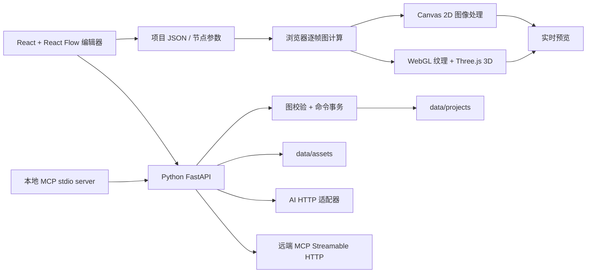

# 架构与扩展指南

TD Open 将实时预览留在浏览器，将项目校验、持久化、AI 服务请求和 MCP 放在 Python 服务。这个分工让初期节点界面容易迭代，也便于通过 Python 扩展 API 与设备能力。当前不是 TouchDesigner 内核重写，不提供 `.toe` / `.tox`、原软件 Python API 或完整 GPU 算子兼容。

## 运行结构



默认入口为 `http://127.0.0.1:8765`。构建后的前端由 FastAPI 同源提供；Vite 开发服务通过代理连接后端。启动命令及依赖安装见 [README](../README.md)。

## 目录职责

| 路径 | 职责 |
| --- | --- |
| `frontend/src/types.ts` | TypeScript 项目、节点、端口和 API 类型 |
| `frontend/src/Workbench.tsx`、`workspaceLayout.ts` | v2 分割树工作区、共享边界缩放、拖动停靠与标签合并；保存在项目 `settings.workspace` |
| `frontend/src/NodeSearch.tsx` | 快捷节点搜索、分类和收藏；收藏保存在 `settings.favoriteNodes` |
| `frontend/src/catalog.ts` | 699 个内置节点的汇总目录、默认参数、案例实例化和连接规则 |
| `frontend/src/templates.ts`、`TemplateGallery.tsx` | 82 个可编辑案例的 recipe、分类、学习目标和搜索图库 |
| `frontend/public/examples/` | 使用浏览器运行时渲染的案例 WebP 缩略图 |
| `examples/`、`scripts/export-examples.mjs` | 从相同 recipe 导出的 82 份项目 JSON，另附空白项目 |
| `frontend/src/nodes/` | 按图像、信号、数据与几何拆分的节点目录和执行模块 |
| `frontend/src/engine.ts` | Canvas/WebGL/Three.js 渲染、音频分析、素材加载与资源释放 |
| `backend/main.py` | FastAPI 入口、项目/资源接口、前端静态文件 |
| `backend/models.py` | Pydantic 项目模型和输入限制 |
| `backend/catalog.py` | 服务端算子注册与本地 Python 插件扫描 |
| `backend/operator_catalog.json` | 从前端目录生成并随源码提交的内置节点合同 |
| `scripts/sync-catalog.mjs` | 生成或检查共享目录，避免前后端重复维护参数定义 |
| `backend/graph.py` | 端口校验、拓扑检查、图命令事务 |
| `backend/runtime.py` | 确定性的标量/文本服务端求值；不渲染像素或 3D |
| `backend/storage.py` | 项目目录边界与原子 JSON 写入 |
| `backend/integrations.py` | AI 配置、生成、对话建议、MCP HTTP 客户端 |
| `backend/mcp_server.py` | 向外部 AI 客户端暴露项目操作的 stdio MCP 服务 |
| `backend/plugins/` | 受信任的本地 Python 扩展，含 `scale.py` 示例 |
| `data/projects/` | 用户项目 JSON |
| `data/assets/` | 上传素材与从 AI 返回的 base64 中提取的媒体文件 |
| `data/exports/` | 界面导出的 PNG、无音轨 WebM 与项目 JSON |
| `data/config/` | 服务商与 MCP 连接配置，可能含密钥；不应提交 Git |
| `docs/` | 架构、范围和开发路线 |

## 项目数据模型

项目 `version` 当前为 `1`。节点类型是稳定字符串，例如 `noise`、`constant`、`render`；显示名称位于 `data.label`，参数位于 `data.params`。连接保存节点 ID 与端口 ID，不保存运行时 GPU 句柄或浏览器对象。组件的 `data.graph` 保存嵌套 Project；编辑器保留层级，运行时通过 `compileNetworks` 展开，路由四组 In/Out 和相对/绝对路径。

```json
{
  "id": "example_project",
  "name": "基本信号",
  "version": 1,
  "nodes": [
    {
      "id": "constant_1",
      "type": "constant",
      "position": {"x": 0, "y": 0},
      "data": {"label": "常量", "params": {"value": 2}}
    },
    {
      "id": "math_1",
      "type": "math",
      "position": {"x": 250, "y": 0},
      "data": {"label": "乘法", "params": {"operation": "multiply", "value": 3}}
    }
  ],
  "edges": [
    {"id": "edge_1", "source": "constant_1", "target": "math_1", "sourceHandle": "out", "targetHandle": "in"}
  ],
  "settings": {}
}
```

节点和连接 ID 必须唯一。服务端检查不存在的节点/端口、类型不匹配、重复占用输入、非有限数值和循环依赖。当前上限为 5,000 个节点、20,000 条连接；这是输入保护上限，不是帧率承诺。一般循环连接被拒绝。`feedback` 已通过节点内部历史画布实现衰减、旋转与缩放拖影，`delay_chop` 通过节点内部时间样本实现信号延迟；这些节点不开放任意循环连线。

保存、读取、校验和命令接口会返回规范化项目：补齐算子参数默认值，并将省略或为 `null` 的端口名解析为对应节点声明的第一个端口。例如，信号连接到噪声节点时默认目标端口为 `mod`。处理过程复制项目，不修改调用方对象；读取旧文件时不会隐式重写磁盘。`/api/validate` 的 `project` 字段提供规范化后的导入内容，导入器应使用该字段。已声明参数的类型和枚举选项也会校验。

内置算子的类型、端口、参数和默认值由前端目录统一声明，再生成 `backend/operator_catalog.json`。两侧以 TOP/CHOP/SOP/DAT 表示画面、信号、几何和文本数据域。共享声明不等于运行逻辑自动生成：新增算子仍须实现浏览器执行器，以及适用的 Python 无状态执行器并验证语义一致。

## 工作区布局与面板停靠

项目格式版本仍是 `version: 1`；工作区是独立的 `settings.workspace.version: 2`。布局采用二叉分割树：`split` 保存水平方向 `row` 或垂直方向 `column`、比例 `ratio` 和两棵子树；`group` 保存面板 `tabs` 和当前 `active` 标签。五个面板 ID 为 `library`、`preview`、`graph`、`inspector`、`assistant`。

```json
{
  "version": 2,
  "reference": {"width": 1280, "height": 760},
  "root": {
    "type": "split", "id": "main", "axis": "column", "ratio": 0.45,
    "first": {"type": "group", "id": "viewer", "tabs": ["preview"], "active": "preview"},
    "second": {"type": "group", "id": "editor", "tabs": ["graph", "inspector"], "active": "graph"}
  },
  "hidden": ["library", "assistant"],
  "preset": "custom"
}
```

拖动公共分隔线修改所属 `split.ratio`，两侧区域共享同一条边界，一侧增大时另一侧同步缩小。边界可用方向键调整，尺寸由子树的最小面板尺寸共同限制。拖动面板标签或标题栏时，目标中央将面板合并到同一标签组，目标上下左右生成对应方向的新分割；原区域空置后自动折叠。节点画布内部的平移/缩放与工作区面板的停靠互不替代。

工作区支持隐藏与恢复、区域最大化、预设布局及重置。持久化内容是布局结构、比例、标签顺序与当前标签，不是页面中的像素截屏。`readLayout` 去除未知或重复面板、修复重复 ID、限制层级与比例，并保证至少保留一个可用区域。旧 v1 浮动窗布局迁移时保留预设与可见面板，重新安排为连续区域；旧窗口的任意重叠坐标不会转换成边界相连的拓扑。窄屏切换为适合滚动浏览的布局，不提供桌面尺寸下的拖动停靠。

## 案例的单一来源

`templates.ts` 与 `referenceTemplates.ts` 声明 82 个案例的 ID、名称、分类、难度、说明、学习目标和外部能力要求。多数案例使用 `recipe.nodes` 与 `recipe.edges` 表示网络，原有起步案例由 `catalog.ts` 的 preset 分支保留。`preset(id)` 为节点分配新 ID、补齐默认参数，并按依赖关系安排画布列，用户打开后可以独立编辑和保存。

图库涵盖图案生成、图像处理、合成与遮罩、音频与信号、三维、数据与文字，以及 AI/MCP 接入。案例覆盖纹理、信号、表格、网格、材质、物理、嵌套组件与外部服务；案例覆盖率不等同于节点实现数量。AI/MCP 案例明确标出所需连接，打开案例不会自动调用收费服务。音频案例需要用户导入音源或授权麦克风，未提供音源时不伪造实时频谱。

`scripts/export-examples.mjs` 读取同一 preset 生成 83 个公开项目文件（82 案例与 1 个空白项目），将随机节点/连接 ID 替换为稳定 ID，使重新导出可在 CI 中比较。`frontend/render-examples.mjs` 使用实际浏览器运行时输出预览素材，图片放在 `frontend/public/examples/`；图库缩略图是示例效果，不替代实时节点计算。新增案例须同步导出 JSON、生成缩略图并通过图结构与浏览器运行验证。

## 图命令与可预览的 AI 修改

`POST /api/commands` 接收 `{project, commands}`，在项目副本上执行命令，完成整体校验后返回新项目。任一命令失败时不会返回半修改项目；接口本身不自动保存到磁盘，需要调用保存接口。

图命令包括 `add_node`、`set_param`、`update_node`、`remove_node` / `delete_node`、`connect`、`disconnect`、`rename_project` 和 `set_playback`。AI 只允许使用其中较小的命令白名单；不允许模型返回的 Python、JavaScript、shell 或任意工具执行。

```json
{
  "op": "set_param",
  "scope": [],
  "id": "constant_1",
  "key": "value",
  "value": 4
}
```

`POST /api/chat` 返回 `{reply, commands, mode}`。`mode: "local"` 表示规则解析，`mode: "ai"` 表示使用了已配置语言模型。生成命令是修改建议，界面应用后才改变图。远端模型生成的命令经过相同图校验；这个约束可以阻止无效图结构，但不是模型能正确理解全部视觉语义的保证。

## 两类运行时

浏览器运行时每帧沿输入依赖读取节点输出，同一帧缓存已求值节点。输出值包括画布、标量、文本、`ChannelBuffer`、`TableData`、网格/几何、材质与场景描述。新增 CHOP 使用带命名通道、采样率和起始时间的采样缓冲区；DAT 使用类型化行列。旧标量/文本节点由适配层读取首样本或 CSV，不代表完整 TouchDesigner 时间片调度。基础纹理源使用 WebGL 着色器，2D 合成和滤镜包含 Canvas 操作，几何通过 Three.js 渲染。因此整个网络不是统一 GPU 管线，Canvas 与 GPU 之间存在数据拷贝。

默认输出画布和 3D 渲染为 640 × 360。Resolution 等 TOP 可调整自身结果；旧下游仍使用默认画幅，不是项目全链路任意分辨率承诺。程序化噪声源在 GPU 上以 320 × 180 计算，再缩放进入 640 × 360 画面管线，以减轻软件 WebGL 的负担。不能通过拉大预览面板推断项目已变成 4K，实际帧率取决于硬件与图的复杂度。

暂停时冻结音频频谱、暂停文件音频与视频，并禁用麦克风音轨；改变参数仍可更新静态画面。切换项目停止当前音频，重开项目后需手动播放已保存的音频素材。未被图引用的媒体会被清理。多个 3D 渲染节点共享模型缓存的几何与材质资源，各自保留变换；缓存拥有这些 GPU 资源，单个实例移除时不会释放其他实例还在使用的资源。几何变形、边线与包围盒转换会创建独立可释放资源，避免修改缓存模型。Mesh、LineSegments 与 Points 的资源均纳入释放路径。

PNG、PCM16 WAV 和 WebM 从运行结果导出，经 API 保存到项目的 `data/exports/`。WebM 是浏览器实时录制，不含音轨，也不保证实际达到请求的帧率；它不等同于离线逐帧渲染。长期运行的资源预算、逐节点 profiler 和跨帧脏标记缓存仍在路线图中。

Python 的 `POST /api/evaluate` 用于无状态标量、文本、54 种无状态采样/表格运算与 Python evaluator，不用于代替浏览器渲染。返回 `values`、`errors`、`skipped`、`skip_reasons` 和 `time`。滞后、积分、计数器、包络、微分、采样保持、弹簧、延迟、窗口统计、迟滞、触发随机与计时依赖连续帧历史，只在浏览器运行；服务端明确跳过并说明原因，不用单帧假值冒充状态计算。上游跳过会传播到下游；独立分支仍然计算。新 Python 节点不会因此自动进入浏览器每帧循环。

有状态算子按节点保存历史；节点参数、输入连接或类型变化时会重置对应状态，切换项目和时间回退也会清理历史。信号窗口最多保存 4096 个样本，暂停或重复时间戳不会无限追加记录。弹簧使用阻尼振子的解析积分，避免高频或长帧间隔导致显式积分发散。

几何描述是可组合的树，支持参数化曲面、路径管道、实例阵列、顶点变形、硬边/三角边线与包围盒。执行器在序列化和分配 GPU 资源前检查展开后的复杂度，最多 4096 个描述对象、64 层，并检查有限数值；此上限不代表所有允许网络都能实时运行。反馈、CPU 像素滤镜、大型几何重建和高分辨率媒体仍会受浏览器与设备性能限制。

## 层级、脚本和协议模块

- `networks.ts` / `backend/networks.py` 负责子图展开、编号端口、Select/OP Viewer/Import Select 隐式依赖、局部时钟与 Replicator 独立副本；保存前检查跨层循环与总预算。`scope: [组件ID, ...]` 将命令作用到内部网络，整批命令仍原子执行。
- `runtimeValues.ts` 定义最多 1,024 通道、262,144 总样本的 ChannelBuffer，以及有界 TableData。`channelDataRuntime.ts` 实现采样处理；`mediaRuntime.ts` 管理显式启用的 Web Audio、PCM 解码和 WebRTC。
- `meshRuntime.ts`、`meshBoolean.ts`、`geometryV2Runtime.ts` 处理有限网格和属性；`sceneRuntime.ts`、`materialRuntime.ts`、`scenePhysics.ts` 生成 Three.js 场景及 cannon-es 刚体。导入模型缓存由 modelRegistry 协调资源所有权。
- `backend/script_runtime.py` 在用户手动操作后启动受信任 Python 子进程；`cook(inputs,time)` 返回可序列化数值、采样、表格、网格或 RGBA。子进程有超时、输出限制和进程组清理，但 **不是宿主权限隔离沙箱**。源码保存在所选数据目录的 `scripts/`。
- `backend/web_runtime.py` 调用 Chromium，输出 PNG 到 `exports/`。网页不能直接调用本机私密 API；它提供截图及有限显式动作，不是持续浏览器纹理流。
- `backend/io_runtime.py` / `io_adapters.py` 管理实际协议会话；`ioRuntime.ts` 负责前端轮询/收发和节点释放。打开硬件桥接入口不代表驱动存在，详见 [I/O 协议与适配器](IO_PROTOCOLS.md)。

切换项目或更换相同 ID 的节点类型/设备来源会关闭旧媒体会话和采集轨道；异步结果在所属状态失效后丢弃。设备权限由明确的界面启用操作触发。

## 共享节点目录

内置节点定义只在 `frontend/src/catalog.ts` 与其导入的 `frontend/src/nodes/*Catalog.ts` 中维护。`node scripts/sync-catalog.mjs` 将目录写入 `backend/operator_catalog.json`，Python 启动时直接读取这个文件，无需安装 Node。前端构建会同步清单；`node scripts/sync-catalog.mjs --check` 只检查清单是否过期，`--stdout` 供跨语言合同测试读取。新增节点时实现浏览器运行分支和必要的服务端无状态分支，再重新生成清单。所有新目录模块均使用相对 TypeScript 导入。

当前内置目录为 699 个入口：204 TOP、211 CHOP、129 SOP、96 DAT、40 COMP、13 MAT、5 AI 和 1 OUT，其中 92 个需要外部适配器。服务端还可额外注册本地 Python 插件，因此 `/api/health` 的算子总数可能大于内置目录数量。生成清单随源代码一起提交。不要手工修改 JSON 中的端口或参数：下次构建会按前端定义覆盖。`backend/plugins/` 仍允许注册额外的 Python 节点，不会被清单生成器覆盖。完整内置列表与使用示例见 [节点手册](NODES.md)。

## Python 扩展示例

`backend/plugins/scale.py` 注册 `python_scale`，从信号输入读取数值并乘以 `factor`。核心接口是：

```python
from backend.catalog import parameter, port, register_operator

def gain(params, inputs, time):
    return float(inputs.get("in", 1)) * float(params.get("factor", 2))

register_operator(
    {
        "type": "my_gain",
        "label": "我的倍率",
        "family": "CHOP",
        "inputs": [port("in", "CHOP", "输入")],
        "outputs": [port("out", "CHOP", "输出")],
        "params": [parameter("factor", "倍率", 2)],
    },
    evaluator=gain,
)
```

把受信任模块放入 `backend/plugins/` 并重启服务后，目录扫描会导入模块，注册结果出现在后端 catalog。若需要在可视化编辑器中使用，还需补充前端目录与执行方式；当前没有通用的前端插件安装器或对 Python evaluator 的逐帧桥接。模块在宿主 Python 进程中执行，不是隔离脚本沙箱。

## HTTP API 概览

完整 schema 以运行中的 `/docs` 与 `/openapi.json` 为准。

| 方法与路径 | 作用 |
| --- | --- |
| `GET /api/health` | 版本、注册算子数量与数据目录 |
| `GET /api/catalog` | 服务端节点定义 |
| `GET /api/projects` | 项目列表 |
| `POST /api/projects` | 校验并保存项目 |
| `GET /api/projects/{id}` | 读取项目 |
| `DELETE /api/projects/{id}` | 删除项目文件 |
| `POST /api/validate` | 校验项目结构与图 |
| `POST /api/commands` | 在项目副本上应用一批图命令 |
| `POST /api/evaluate` | 计算服务端支持的标量/文本节点 |
| `POST /api/upload` | multipart 上传素材，单文件上限 100 MB |
| `GET /api/assets/{filename}` | 读取已上传资源 |
| `POST /api/artifacts` | multipart 保存 PNG / WebM / WAV / JSON 导出文件，单文件上限 100 MB |
| `GET /api/exports/{filename}` | 以附件方式读取已保存的导出文件 |
| `GET /api/providers` / `POST /api/providers` | 列举或保存 AI 连接 |
| `POST /api/ai/generate` | 发起真实生成请求 |
| `POST /api/chat` | 生成图修改建议 |
| `GET /api/mcp/servers` / `POST /api/mcp/servers` | 列举或保存 MCP 连接 |
| `POST /api/mcp/servers/{id}/tools` | 向远端 MCP 请求工具列表 |
| `POST /api/mcp/call` | 调用远端允许的工具 |

## AI 服务商适配

每条连接绑定一种 `capability`：`text`、`image`、`music` 或 `3d`。`kind: "openai"` 使用 `/chat/completions` 或 `/images/generations`；`kind: "http"` 使用自定义路径和 JSON body 模板。通用模板支持 `{{prompt}}`、`{{model}}`、`{{parameters}}` 与 `{{capability}}` 的值替换，不执行表达式。

例如一个本地音乐服务的连接结构：

```json
{
  "id": "local_music",
  "name": "本地音乐生成",
  "kind": "http",
  "base_url": "http://127.0.0.1:9000",
  "path": "/generate",
  "model": "your-model",
  "capability": "music",
  "body_template": {
    "prompt": "{{prompt}}",
    "model": "{{model}}",
    "options": "{{parameters}}"
  }
}
```

这是适配格式示例，仓库不会启动该地址上的音乐模型。调用 `POST /api/ai/generate` 时提供 `provider_id`、`capability`、`prompt` 与可选 `parameters`。Bearer 密钥由服务端添加，不写入请求模板。

适配器从常见 JSON 字段归一化文本、媒体 URL 和 base64；返回的 base64 媒体会存入 `data/assets/`，避免把大段编码重复写进项目 JSON。远端 URL 通常保留为链接，不代表该远端素材已经完整下载到本机；实际格式支持与错误行为见 [AI 接入说明](AI_API.md)。没有媒体 URL 的异步响应需要后续查询，当前未实现统一任务轮询。图像加载、视频播放、音频分析和 glTF/GLB 读取仍受浏览器格式及远端 CORS 策略限制。上传接受的文件扩展名不等于浏览器已经支持对应渲染格式。

## MCP 的两个方向

TD Open 的 MCP 服务端通过 stdio 向外部 AI 客户端提供项目工具，图修改仍调用 HTTP 图校验路径。另一个方向由 `backend/integrations.py` 作为 Streamable HTTP 客户端访问使用者配置的远端 MCP 服务，分别完成初始化、工具列举与工具调用。

应用服务启动后，在仓库根目录执行 `.venv/bin/python -m backend.mcp_server`。stdio 服务面向 MCP 客户端启动，不能把它的标准输出用作普通交互终端。`TD_OPEN_APP_URL` 可指定应用服务地址，默认 `http://127.0.0.1:8765`。工具包括 `list_projects`、`get_project`、`list_operators` 与 `apply_graph_commands`；`list_operators` 读取 `/api/catalog`。`apply_graph_commands(project_id, commands, apply=False)` 默认返回预览，`apply=True` 才保存修改后的项目，只允许 `add_node`、`set_param`、`remove_node`、`connect`、`disconnect` 与 `rename_project`。

浏览器在当前项目无未保存修改时每 4 秒轮询已保存项目，并同步外部工具的更新。此机制不提供多人协同锁或修改冲突合并。

远端可配置 Bearer token 与 `allowed_tools`。允许列表为 `null` 时可调用所列工具，为空列表时不允许调用；调用前还会检查工具确实存在。当前每次请求创建会话，尚无长期会话、OAuth、资源订阅或完整 MCP 能力集。协议版本由安装的官方 Python SDK 协商，不声称兼容所有最新草案。

MCP 规范和 SDK 参考：[标准 transport](https://modelcontextprotocol.io/specification/2025-11-25/basic/transports)、[Python SDK client](https://py.sdk.modelcontextprotocol.io/v1/client/)、[Python SDK server](https://py.sdk.modelcontextprotocol.io/v1/server/)。

## 存储与本地运行边界

项目采用临时文件加 `os.replace` 的原子替换方式保存。资源上传使用生成的文件名，用户原文件名不作为磁盘路径。API 密钥和 MCP token 保存在 `data/config/`，配置目录权限设为 `0700`，配置文件为 `0600`；它们是本机权限保护的明文文件，不是加密保险箱。配置列表接口会隐藏密钥值。

数据目录默认为项目下的 `data/`，可通过 `TD_DATA_DIR` 切换到项目内部的其他目录，例如 `.cache/demo-data`；项目、资源、导出与连接配置均放在所选目录中。环境变量指向项目目录外时，应用拒绝启动。自行选择的目录应加入 Git 忽略规则，默认 `data/` 与 `.cache/` 已忽略。

默认监听 localhost，浏览器写请求要求同源。当前没有账户认证、角色权限、多租户隔离或服务端任意 URL 访问的公共部署策略，因此只能按本地工具方式使用；允许使用者配置本地 AI/MCP 服务是有意设计。需要多人或公网部署时，必须先完善认证、网络访问策略与部署配置。

各功能的完整缺口见 [功能矩阵](FEATURE_MATRIX.md)，后续设计顺序见 [路线图](ROADMAP.md)。
