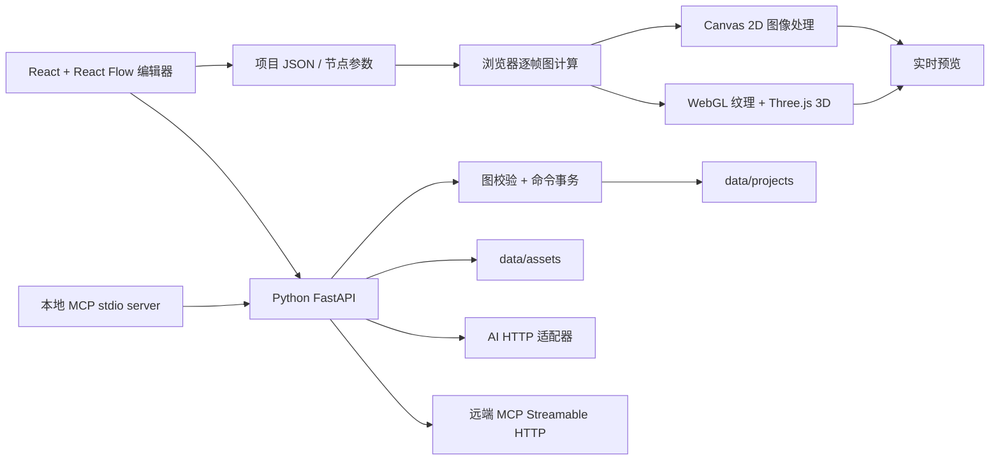

# 架构与扩展指南

TD Open 将实时预览留在浏览器，将项目校验、持久化、AI 服务请求和 MCP 放在 Python 服务。这个分工让初期节点界面容易迭代，也便于通过 Python 扩展 API 与设备能力。当前不是 TouchDesigner 内核重写，不提供 `.toe` / `.tox`、原软件 Python API 或完整 GPU 算子兼容。

## 运行结构



默认入口为 `http://127.0.0.1:8765`。构建后的前端由 FastAPI 同源提供；Vite 开发服务通过代理连接后端。启动命令及依赖安装见 [README](../README.md)。

## 目录职责

| 路径 | 职责 |
| --- | --- |
| `frontend/src/types.ts` | TypeScript 项目、节点、端口和 API 类型 |
| `frontend/src/catalog.ts` | 前端节点目录、默认参数、示例图和连接规则 |
| `frontend/src/engine.ts` | Canvas/WebGL/Three.js 渲染、音频分析、素材加载与资源释放 |
| `backend/main.py` | FastAPI 入口、项目/资源接口、前端静态文件 |
| `backend/models.py` | Pydantic 项目模型和输入限制 |
| `backend/catalog.py` | 服务端算子注册与本地 Python 插件扫描 |
| `backend/graph.py` | 端口校验、拓扑检查、图命令事务 |
| `backend/runtime.py` | 确定性的标量/文本服务端求值；不渲染像素或 3D |
| `backend/storage.py` | 项目目录边界与原子 JSON 写入 |
| `backend/integrations.py` | AI 配置、生成、对话建议、MCP HTTP 客户端 |
| `backend/mcp_server.py` | 向外部 AI 客户端暴露项目操作的 stdio MCP 服务 |
| `backend/plugins/` | 受信任的本地 Python 扩展，含 `scale.py` 示例 |
| `data/projects/` | 用户项目 JSON |
| `data/assets/` | 上传素材与从 AI 返回的 base64 中提取的媒体文件 |
| `data/exports/` | 界面导出的 PNG、无音轨 WebM 与项目 JSON |
| `data/config/` | 服务商与 MCP 连接配置，可能含密钥；不应提交 Git |
| `docs/` | 架构、范围和开发路线 |

## 项目数据模型

项目 `version` 当前为 `1`。节点类型是稳定字符串，例如 `noise`、`constant`、`render`；显示名称位于 `data.label`，参数位于 `data.params`。连接保存节点 ID 与端口 ID，不保存运行时 GPU 句柄或浏览器对象。

```json
{
  "id": "example_project",
  "name": "基本信号",
  "version": 1,
  "nodes": [
    {
      "id": "constant_1",
      "type": "constant",
      "position": {"x": 0, "y": 0},
      "data": {"label": "常量", "params": {"value": 2}}
    },
    {
      "id": "math_1",
      "type": "math",
      "position": {"x": 250, "y": 0},
      "data": {"label": "乘法", "params": {"operation": "multiply", "value": 3}}
    }
  ],
  "edges": [
    {"id": "edge_1", "source": "constant_1", "target": "math_1", "sourceHandle": "out", "targetHandle": "in"}
  ],
  "settings": {}
}
```

节点和连接 ID 必须唯一。服务端检查不存在的节点/端口、类型不匹配、重复占用输入、非有限数值和循环依赖。当前上限为 500 个节点、2,000 条连接；这是输入保护上限，不是帧率承诺。一般循环连接被拒绝，反馈效果需要未来专门设计的延迟/帧缓存节点。

保存、读取、校验和命令接口会返回规范化项目：补齐算子参数默认值，并将省略或为 `null` 的端口名解析为对应节点声明的第一个端口。例如，信号连接到噪声节点时默认目标端口为 `mod`。处理过程复制项目，不修改调用方对象；读取旧文件时不会隐式重写磁盘。`/api/validate` 的 `project` 字段提供规范化后的导入内容，导入器应使用该字段。已声明参数的类型和枚举选项也会校验。

前端和后端各有一份算子声明；新增节点或参数时必须同步两侧的类型、端口和默认值。两侧以 TOP/CHOP/SOP/DAT 表示画面、信号、几何和文本数据域。完整的 schema 自动生成尚未实现，是后续减少漂移的重要工作。

## 图命令与可预览的 AI 修改

`POST /api/commands` 接收 `{project, commands}`，在项目副本上执行命令，完成整体校验后返回新项目。任一命令失败时不会返回半修改项目；接口本身不自动保存到磁盘，需要调用保存接口。

图命令包括 `add_node`、`set_param`、`update_node`、`remove_node` / `delete_node`、`connect`、`disconnect`、`rename_project` 和 `set_playback`。AI 只允许使用其中较小的命令白名单；不允许模型返回的 Python、JavaScript、shell 或任意工具执行。

```json
{
  "op": "set_param",
  "id": "constant_1",
  "key": "value",
  "value": 4
}
```

`POST /api/chat` 返回 `{reply, commands, mode}`。`mode: "local"` 表示规则解析，`mode: "ai"` 表示使用了已配置语言模型。生成命令是修改建议，界面应用后才改变图。远端模型生成的命令经过相同图校验；这个约束可以阻止无效图结构，但不是模型能正确理解全部视觉语义的保证。

## 两类运行时

浏览器运行时每帧沿输入依赖读取节点输出，同一帧缓存已求值节点。输出值包括画布、数值、文本和几何描述。基础纹理源使用 WebGL 着色器，2D 合成和滤镜包含 Canvas 操作，几何通过 Three.js 渲染。因此整个网络不是统一 GPU 管线，Canvas 与 GPU 之间存在数据拷贝。

当前输出画布和 3D 渲染为 640 × 360。程序化噪声源在 GPU 上以 320 × 180 计算，再缩放进入 640 × 360 画面管线，以减轻软件 WebGL 的负担。不能通过拉大预览面板推断项目已变成 4K，实际帧率取决于硬件与图的复杂度。

暂停时冻结音频频谱、暂停文件音频与视频，并禁用麦克风音轨；改变参数仍可更新静态画面。切换项目停止当前音频，重开项目后需手动播放已保存的音频素材。未被图引用的媒体会被清理。多个 3D 渲染节点共享模型缓存的几何与材质资源，各自保留变换；缓存拥有这些 GPU 资源，单个实例移除时不会释放其他实例还在使用的资源。

PNG 和 WebM 从预览画布导出，经 API 保存到项目的 `data/exports/`。WebM 是浏览器实时录制，不含音轨，也不保证实际达到请求的帧率；它不等同于离线逐帧渲染。长期运行的资源预算、逐节点 profiler 和跨帧脏标记缓存仍在路线图中。

Python 的 `POST /api/evaluate` 用于标量、文本与 Python evaluator，不用于代替浏览器渲染。返回 `values`、`errors`、`skipped` 和 `time`；`skipped` 表示该类型未在 Python 运行时求值，不是远程渲染失败。新 Python 节点不会因此自动进入浏览器每帧循环。

## Python 扩展示例

`backend/plugins/scale.py` 注册 `python_scale`，从信号输入读取数值并乘以 `factor`。核心接口是：

```python
from backend.catalog import parameter, port, register_operator

def gain(params, inputs, time):
    return float(inputs.get("in", 1)) * float(params.get("factor", 2))

register_operator(
    {
        "type": "my_gain",
        "label": "我的倍率",
        "family": "CHOP",
        "inputs": [port("in", "CHOP", "输入")],
        "outputs": [port("out", "CHOP", "输出")],
        "params": [parameter("factor", "倍率", 2)],
    },
    evaluator=gain,
)
```

把受信任模块放入 `backend/plugins/` 并重启服务后，目录扫描会导入模块，注册结果出现在后端 catalog。若需要在可视化编辑器中使用，还需补充前端目录与执行方式；当前没有通用的前端插件安装器或对 Python evaluator 的逐帧桥接。模块在宿主 Python 进程中执行，不是隔离脚本沙箱。

## HTTP API 概览

完整 schema 以运行中的 `/docs` 与 `/openapi.json` 为准。

| 方法与路径 | 作用 |
| --- | --- |
| `GET /api/health` | 版本、注册算子数量与数据目录 |
| `GET /api/catalog` | 服务端节点定义 |
| `GET /api/projects` | 项目列表 |
| `POST /api/projects` | 校验并保存项目 |
| `GET /api/projects/{id}` | 读取项目 |
| `DELETE /api/projects/{id}` | 删除项目文件 |
| `POST /api/validate` | 校验项目结构与图 |
| `POST /api/commands` | 在项目副本上应用一批图命令 |
| `POST /api/evaluate` | 计算服务端支持的标量/文本节点 |
| `POST /api/upload` | multipart 上传素材，单文件上限 100 MB |
| `GET /api/assets/{filename}` | 读取已上传资源 |
| `POST /api/artifacts` | multipart 保存 PNG / WebM / JSON 导出文件，单文件上限 100 MB |
| `GET /api/exports/{filename}` | 以附件方式读取已保存的导出文件 |
| `GET /api/providers` / `POST /api/providers` | 列举或保存 AI 连接 |
| `POST /api/ai/generate` | 发起真实生成请求 |
| `POST /api/chat` | 生成图修改建议 |
| `GET /api/mcp/servers` / `POST /api/mcp/servers` | 列举或保存 MCP 连接 |
| `POST /api/mcp/servers/{id}/tools` | 向远端 MCP 请求工具列表 |
| `POST /api/mcp/call` | 调用远端允许的工具 |

## AI 服务商适配

每条连接绑定一种 `capability`：`text`、`image`、`music` 或 `3d`。`kind: "openai"` 使用 `/chat/completions` 或 `/images/generations`；`kind: "http"` 使用自定义路径和 JSON body 模板。通用模板支持 `{{prompt}}`、`{{model}}`、`{{parameters}}` 与 `{{capability}}` 的值替换，不执行表达式。

例如一个本地音乐服务的连接结构：

```json
{
  "id": "local_music",
  "name": "本地音乐生成",
  "kind": "http",
  "base_url": "http://127.0.0.1:9000",
  "path": "/generate",
  "model": "your-model",
  "capability": "music",
  "body_template": {
    "prompt": "{{prompt}}",
    "model": "{{model}}",
    "options": "{{parameters}}"
  }
}
```

这是适配格式示例，仓库不会启动该地址上的音乐模型。调用 `POST /api/ai/generate` 时提供 `provider_id`、`capability`、`prompt` 与可选 `parameters`。Bearer 密钥由服务端添加，不写入请求模板。

适配器从常见 JSON 字段归一化文本、媒体 URL 和 base64；返回的 base64 媒体会存入 `data/assets/`，避免把大段编码重复写进项目 JSON。远端 URL 通常保留为链接，不代表该远端素材已经完整下载到本机；实际格式支持与错误行为见 [AI 接入说明](AI_API.md)。没有媒体 URL 的异步响应需要后续查询，当前未实现统一任务轮询。图像加载、视频播放、音频分析和 glTF/GLB 读取仍受浏览器格式及远端 CORS 策略限制。上传接受的文件扩展名不等于浏览器已经支持对应渲染格式。

## MCP 的两个方向

TD Open 的 MCP 服务端通过 stdio 向外部 AI 客户端提供项目工具，图修改仍调用 HTTP 图校验路径。另一个方向由 `backend/integrations.py` 作为 Streamable HTTP 客户端访问使用者配置的远端 MCP 服务，分别完成初始化、工具列举与工具调用。

应用服务启动后，在仓库根目录执行 `.venv/bin/python -m backend.mcp_server`。stdio 服务面向 MCP 客户端启动，不能把它的标准输出用作普通交互终端。`TD_OPEN_APP_URL` 可指定应用服务地址，默认 `http://127.0.0.1:8765`。工具包括 `list_projects`、`get_project`、`list_operators` 与 `apply_graph_commands`；`list_operators` 读取 `/api/catalog`。`apply_graph_commands(project_id, commands, apply=False)` 默认返回预览，`apply=True` 才保存修改后的项目，只允许 `add_node`、`set_param`、`remove_node`、`connect`、`disconnect` 与 `rename_project`。

浏览器在当前项目无未保存修改时每 4 秒轮询已保存项目，并同步外部工具的更新。此机制不提供多人协同锁或修改冲突合并。

远端可配置 Bearer token 与 `allowed_tools`。允许列表为 `null` 时可调用所列工具，为空列表时不允许调用；调用前还会检查工具确实存在。当前每次请求创建会话，尚无长期会话、OAuth、资源订阅或完整 MCP 能力集。协议版本由安装的官方 Python SDK 协商，不声称兼容所有最新草案。

MCP 规范和 SDK 参考：[标准 transport](https://modelcontextprotocol.io/specification/2025-11-25/basic/transports)、[Python SDK client](https://py.sdk.modelcontextprotocol.io/v1/client/)、[Python SDK server](https://py.sdk.modelcontextprotocol.io/v1/server/)。

## 存储与本地运行边界

项目采用临时文件加 `os.replace` 的原子替换方式保存。资源上传使用生成的文件名，用户原文件名不作为磁盘路径。API 密钥和 MCP token 保存在 `data/config/`，配置目录权限设为 `0700`，配置文件为 `0600`；它们是本机权限保护的明文文件，不是加密保险箱。配置列表接口会隐藏密钥值。

数据目录默认为项目下的 `data/`，可通过 `TD_DATA_DIR` 切换到项目内部的其他目录，例如 `.cache/demo-data`；项目、资源、导出与连接配置均放在所选目录中。环境变量指向项目目录外时，应用拒绝启动。自行选择的目录应加入 Git 忽略规则，默认 `data/` 与 `.cache/` 已忽略。

默认监听 localhost，浏览器写请求要求同源。当前没有账户认证、角色权限、多租户隔离或服务端任意 URL 访问的公共部署策略，因此只能按本地工具方式使用；允许使用者配置本地 AI/MCP 服务是有意设计。需要多人或公网部署时，必须先完善认证、网络访问策略与部署配置。

各功能的完整缺口见 [功能矩阵](FEATURE_MATRIX.md)，后续设计顺序见 [路线图](ROADMAP.md)。
