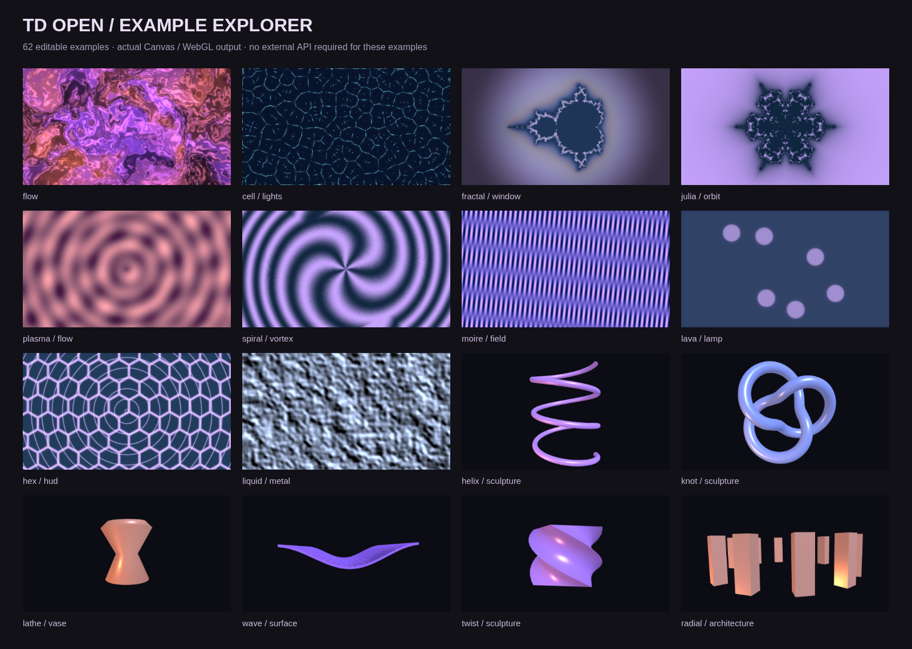

# 案例索引

62 个可编辑案例，加 1 份空白作品。点击编辑器的“示例作品”可以搜索、分类、筛选并打开；也可以下载下列 JSON 后导入。缩略图来自内置引擎的实际输出；AI / MCP 案例使用明确标注的连接说明卡片。

## 入门

| 案例 | 节点数 | 练习方向 | 运行条件 |
| --- | ---: | --- | --- |
| [流光实验](../examples/flow.tdopen.json) | 5 | 修改噪声尺度，再比较柔光前后的输出。 | 无需外部服务 |

## 音频与信号

| 案例 | 节点数 | 练习方向 | 运行条件 |
| --- | ---: | --- | --- |
| [声音的形状](../examples/particles.tdopen.json) | 4 | 先观察无输入的粒子，再导入音频或启用麦克风。 | 导入音频或授权麦克风 |
| [音乐频谱](../examples/audio-spectrum.tdopen.json) | 4 | 导入音乐并手动播放，或授权麦克风；无音源时不生成假频谱。 | 导入音频或授权麦克风 |
| [节拍圆环](../examples/pulse-rings.tdopen.json) | 4 | 改变 BPM 与触发衰减，观察节奏与视觉的响应。 | 无需外部服务 |
| [弹簧运动](../examples/spring-motion.tdopen.json) | 4 | 比较原始方波与弹簧输出，改变阻尼。 | 无需外部服务 |
| [步进动画](../examples/step-sequence.tdopen.json) | 5 | 编辑序列并调整变化速度，观察每个阶段之间的过渡。 | 无需外部服务 |
| [ADSR 光环](../examples/signal-envelope.tdopen.json) | 4 | 改变起音、衰减和释放时间，观察形状的连续变化。 | 无需外部服务 |
| [迟滞切换](../examples/schmitt-trigger.tdopen.json) | 6 | 分别调整开启和关闭阈值，观察切换不会在单一临界点抖动。 | 无需外部服务 |

## 三维

| 案例 | 节点数 | 练习方向 | 运行条件 |
| --- | ---: | --- | --- |
| [空间练习](../examples/3d.tdopen.json) | 4 | 切换线框模式，改变细分与旋转速度。 | 无需外部服务 |
| [双物体空间](../examples/geometry-lab.tdopen.json) | 7 | 移动任一物体，观察合并后仍保留独立变换。 | 无需外部服务 |
| [胶囊结构](../examples/capsule-study.tdopen.json) | 3 | 调整胶囊的尺寸与细分，观察曲面连接。 | 无需外部服务 |
| [柏拉图多面体](../examples/polyhedra.tdopen.json) | 3 | 切换多面体种类，比较实体与线框。 | 无需外部服务 |
| [螺旋雕塑](../examples/helix-sculpture.tdopen.json) | 3 | 改变圈数、半径和管径，查看真实三维结构。 | 无需外部服务 |
| [环面结雕塑](../examples/knot-sculpture.tdopen.json) | 3 | 改变结的整数参数与管径，观察拓扑外观。 | 无需外部服务 |
| [旋转成器](../examples/lathe-vase.tdopen.json) | 3 | 改变截面与旋转角度，观察侧面轮廓。 | 无需外部服务 |
| [挤出标记](../examples/extruded-sign.tdopen.json) | 3 | 改变深度与倒角，比较正面和侧面。 | 无需外部服务 |
| [波动地形](../examples/wave-surface.tdopen.json) | 4 | 调整波高和频率，并比较线框密度。 | 无需外部服务 |
| [扭转雕塑](../examples/twist-sculpture.tdopen.json) | 4 | 改变扭转角度，比较变形前后的几何。 | 无需外部服务 |
| [放射构筑](../examples/radial-architecture.tdopen.json) | 4 | 改变复制数量和排列半径，观察每个副本的变换。 | 无需外部服务 |
| [散点雕塑](../examples/scatter-cloud.tdopen.json) | 4 | 改变随机种子与分布范围，查看同一物体的不同排列。 | 无需外部服务 |
| [渐缩结构](../examples/taper-tower.tdopen.json) | 4 | 改变渐缩系数，比较顶部与底部。 | 无需外部服务 |
| [网格骨架](../examples/wire-skeleton.tdopen.json) | 4 | 比较线框算子与渲染器线框选项。 | 无需外部服务 |
| [边界盒](../examples/bounding-box.tdopen.json) | 4 | 切换输入形状，观察包围范围如何改变。 | 无需外部服务 |
| [噪声雕塑](../examples/noise-sculpture.tdopen.json) | 4 | 改变扰动强度与种子，观察表面与轮廓。 | 无需外部服务 |

## 图案生成

| 案例 | 节点数 | 练习方向 | 运行条件 |
| --- | ---: | --- | --- |
| [万花筒与反馈](../examples/kaleidoscope.tdopen.json) | 5 | 改变扇区数和反馈衰减；时间归零会清除历史帧。 | 无需外部服务 |
| [极坐标隧道](../examples/radial-tunnel.tdopen.json) | 4 | 改变条纹数量并观察极坐标变换；反馈保留运动轨迹。 | 无需外部服务 |
| [霓虹声纹](../examples/neon-waves.tdopen.json) | 4 | 调整曲线数量、波幅和柔光半径。 | 无需外部服务 |
| [细胞边界](../examples/cell-lights.tdopen.json) | 6 | 改变细胞尺度和边缘增益，观察结构。 | 无需外部服务 |
| [分形之窗](../examples/fractal-window.tdopen.json) | 4 | 改变分形中心与缩放，再调整颜色曲线。 | 无需外部服务 |
| [Julia 对称花](../examples/julia-orbit.tdopen.json) | 3 | 分别改变复数参数与扇区数，理解两个处理阶段。 | 无需外部服务 |
| [等离子流](../examples/plasma-flow.tdopen.json) | 3 | 修改色相偏移，与直接修改源图案参数比较。 | 无需外部服务 |
| [螺旋漩涡](../examples/spiral-vortex.tdopen.json) | 3 | 改变螺旋密度和扭转力度，观察中心与边缘。 | 无需外部服务 |
| [摩尔纹场](../examples/moire-field.tdopen.json) | 4 | 改变图案频率，观察细节与整体波纹的关系。 | 无需外部服务 |
| [熔岩灯](../examples/lava-lamp.tdopen.json) | 4 | 改变场的密度与双色映射，观察色块相连的过程。 | 无需外部服务 |

## 数据与文字

| 案例 | 节点数 | 练习方向 | 运行条件 |
| --- | ---: | --- | --- |
| [数据变成画面](../examples/data-driven.tdopen.json) | 6 | 编辑 CSV 第二行的 0.6，观察网格角度实时改变。 | 无需外部服务 |
| [流体字形](../examples/masked-title.tdopen.json) | 4 | 修改文字内容，再切换遮罩反转，理解图像与遮罩两个输入。 | 无需外部服务 |
| [数据排字](../examples/typography.tdopen.json) | 4 | 修改文本、大小写方式与画面字体大小。 | 无需外部服务 |
| [JSON 信息牌](../examples/json-dashboard.tdopen.json) | 4 | 修改 name 字段或 JSON 路径，观察数据到图像的转换。 | 无需外部服务 |
| [去重排序](../examples/data-sort.tdopen.json) | 5 | 加入重复行，比较排序前后与唯一项输出。 | 无需外部服务 |
| [表格转 JSON](../examples/data-table.tdopen.json) | 5 | 改变表格的值与排序列，查看 JSON 数组的顺序。 | 无需外部服务 |
| [节拍计数器](../examples/signal-counter.tdopen.json) | 5 | 调节节拍速度，观察 CHOP → DAT → TOP 的转换。 | 无需外部服务 |

## AI 与 MCP

| 案例 | 节点数 | 练习方向 | 运行条件 |
| --- | ---: | --- | --- |
| [想象力画布](../examples/ai.tdopen.json) | 3 | 配置图片服务，输入提示词并手动运行；不会自动发请求。 | 配置 AI 服务，手动生成 |
| [AI 文案海报](../examples/ai-poster.tdopen.json) | 3 | 选择文本服务、运行文案生成，再修改文字节点的排版。 | 配置 AI 服务，手动生成 |
| [AI 音乐视觉](../examples/ai-music-visual.tdopen.json) | 4 | 配置音乐 HTTP 服务、运行生成并点击播放音乐，再观察粒子。 | 配置 AI 服务，手动生成 |
| [AI 模型展台](../examples/ai-model-stage.tdopen.json) | 4 | 配置 3D 服务并返回可访问 GLB/glTF；调整变换节点。 | 配置 AI 服务，手动生成 |
| [MCP 数据看板](../examples/mcp-dashboard.tdopen.json) | 3 | 连接 MCP 服务，选择工具并填写参数，再手动执行。 | 连接 MCP，手动调用 |
| [AI 图案再创作](../examples/ai-texture.tdopen.json) | 4 | 配置图片服务手动生成，再尝试对称与通道分离。 | 配置 AI 服务，手动生成 |

## 图像处理

| 案例 | 节点数 | 练习方向 | 运行条件 |
| --- | ---: | --- | --- |
| [墨线轮廓](../examples/ink-outline.tdopen.json) | 4 | 提高边缘阈值去掉弱纹理，再调整双色的明暗颜色。 | 无需外部服务 |
| [像素海报](../examples/pixel-poster.tdopen.json) | 5 | 比较像素块大小与色阶数量，它们分别控制空间和颜色精度。 | 无需外部服务 |
| [色散拖影](../examples/chromatic-trails.tdopen.json) | 5 | 观察反馈旋转、衰减与色差距离的组合。 | 无需外部服务 |
| [液态网格](../examples/displacement-grid.tdopen.json) | 5 | 改变位移量和噪声尺度，观察位移图与结果的对应关系。 | 无需外部服务 |
| [半调印刷](../examples/halftone-print.tdopen.json) | 4 | 改变网点尺寸和双色映射，观察亮度如何变成点阵。 | 无需外部服务 |
| [有序抖色](../examples/pixel-dither.tdopen.json) | 3 | 比较抖色结果与普通色阶分段。 | 无需外部服务 |
| [液态金属](../examples/liquid-metal.tdopen.json) | 4 | 改变浮雕方向，再调节颜色平衡。 | 无需外部服务 |
| [复古显示器](../examples/scanline-screen.tdopen.json) | 4 | 分别调节像素块与扫描线间距。 | 无需外部服务 |
| [故障信号](../examples/glitch-signal.tdopen.json) | 4 | 改变故障位移与 RGB 分离距离。 | 无需外部服务 |
| [镜头实验](../examples/optics-lab.tdopen.json) | 4 | 观察直线如何弯曲，比较两个镜头节点。 | 无需外部服务 |
| [放射光束](../examples/zoom-streaks.tdopen.json) | 4 | 调整星角数量和模糊采样，理解放射方向。 | 无需外部服务 |
| [形态学墨迹](../examples/ink-morphology.tdopen.json) | 5 | 分别旁观膨胀和腐蚀的输出，比较边缘增减。 | 无需外部服务 |

## 合成与遮罩

| 案例 | 节点数 | 练习方向 | 运行条件 |
| --- | ---: | --- | --- |
| [六角扫描](../examples/hex-hud.tdopen.json) | 5 | 分别预览两路输入，改变合成强度。 | 无需外部服务 |
| [渐变叠色](../examples/color-composite.tdopen.json) | 4 | 比较乘法合成和滤色合成对亮暗区域的影响。 | 无需外部服务 |
| [双画面交叉渐变](../examples/transitions.tdopen.json) | 5 | 将 LFO 的振幅与偏移都设为 0.5，使切换值落在 0–1。 | 无需外部服务 |

[创建空白作品](../examples/empty.tdopen.json)

新增案例请编辑 `frontend/src/templates.ts`，然后运行 `node scripts/export-examples.mjs`。浏览器缩略图由 `TD_CHROMIUM=/path/to/chromium node frontend/render-examples.mjs` 生成，脚本同时检查全部案例的实际执行错误。
