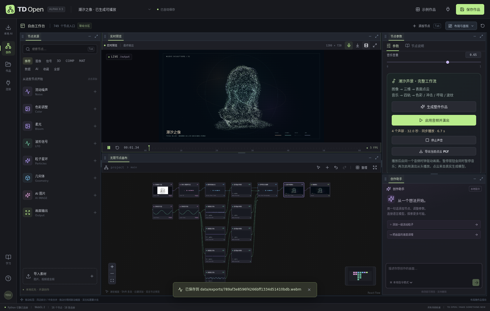
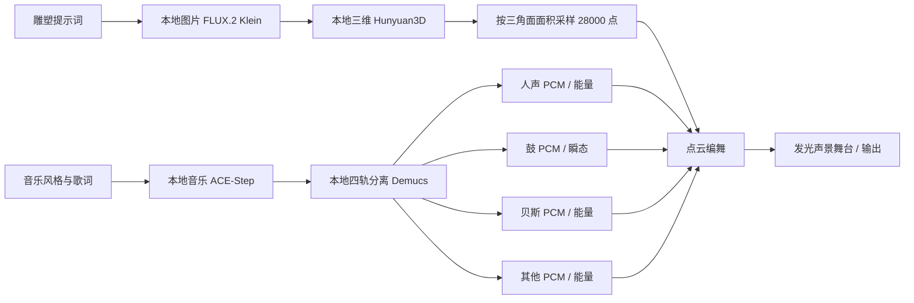

# 潮汐之像：本地生成与四轨点云声景

这是一张可以直接编辑和重新生成的 16 节点工作流。雕塑与音乐分别由本机模型生成，点云采样真实模型表面，四个分离后的 WAV 声部各自驱动画面。模型权重与生成文件保存在本项目内，不需要填写云 API 密钥。

[观看带声音的 12 秒演出片段](media/tidal-muse-preview.mp4)。本机还保留了完整 32 秒 MP4。

## 在这台机器直接播放

运行 `./scripts/start.sh`，打开 http://127.0.0.1:8765，在作品列表选择 **潮汐之像 · 已生成可播放**。直接点击预览画面上方的 **播放生成音乐**，或点击底部播放按钮；不需要先选中节点。选择 **潮汐声景舞台** 后，参数面板中的 **启用音频并演出** 也可从头播放。浏览器会读取原始音乐与四条真实声部文件，并从同一个音频时钟开始演出。准备音频需要几秒钟；全局暂停 / 播放会同步暂停 / 继续声音与画面。

选择输出节点可以查看最终画面。预览窗口可以最大化；输出为 1280 × 720。点击截图会保存 PNG，点击录制会保存包含演出声音的 WebM。舞台参数面板还有 **导出当前点云 PLY**，可用 Blender、CloudCompare 等软件继续处理。

已经生成的案例原件保存在 `data/examples/tidal_muse_ready.json`，首次编辑会自动另存到 `data/projects/project_*.json`，后续继续保存该项目，不会覆盖案例。此前的编辑也已保留为独立项目；原有 `data/projects/tidal_muse_ready.json` 文件保留在磁盘。原始 PNG、GLB、音乐和四轨 WAV 在 `data/assets/`；演出 MP4、截图、点云与验收报告在 `data/artifacts/`。这些本机数据不随 Git 仓库发布。

## 从空白案例重新生成

1. 打开“本地模型中心”，安装 **FLUX.2 Klein 4B、Hunyuan3D 2.1、ACE-Step 1.5、Demucs 四轨**。已有模型无需再次下载。完整一键安装与手动安装步骤见 [本地 AI 安装指南](LOCAL_AI.md)。
2. 打开“示例作品”，搜索 **潮汐之像**，或导入 [公开工作流 JSON](../examples/tidal-muse.tdopen.json)。公开案例包含提示词、参数和连线，其他机器需要自行生成素材；本机已生成时，案例库会优先打开带素材的原件。首次编辑自动新建独立项目，导入 JSON 则直接创建新项目。
3. 选中“潮汐声景舞台”，点击 **生成整件作品**。系统依照连线依次运行图片、三维、音乐和分轨四个实际任务，并自动把结果接到后续节点。
4. 等面板提示“四步素材已生成”，点击 **启用音频并演出**。浏览器需要用户手动点击才能启用声音。

可取消当前生成；切换作品会停止后续任务安排，已生成文件保留。普通播放不会自动触发模型推理。修改生成提示词后，重新生成整件作品会替换当前工作流的素材结果。

## 听不到音乐时

预览区显示 **音乐未启用** 时，画面可能已经运行，但声音还没有启用。点击 **播放生成音乐**；新版本的普通播放按钮和空格也会在案例首次播放时启用音乐。

预览区的音量、静音与输出电平控制的是生成音乐，麦克风按钮控制输入。若显示 **音乐已静音**，点击取消静音或提高音乐音量；若显示 **浏览器声音尚未启用**，点击 **启用浏览器声音**。

电平跳动但听不到时，先检查浏览器标签页是否静音，以及电脑选中的扬声器 / 耳机和系统音量。声音由打开网页的浏览器播放；通过 SSH 访问远程服务器时，声音在浏览器所在电脑输出。点击 **试听原始音乐** 可单独打开已保存的 WAV，帮助区分播放状态与音频设备问题。

## 两条线路

| 声部 | 真正分析的内容 | 画面响应 | 主要可调参数 |
| --- | --- | --- | --- |
| vocals 人声 | 独立人声 WAV 的双声道 RMS | 暖金与青色之间变化 | 人声色彩、暖色、冷色 |
| drums 鼓 | 独立鼓 WAV 的能量与上升瞬态 | 沿模型表面法线跳动 | 鼓点冲击、攻击 / 释放 |
| bass 贝斯 | 独立贝斯 WAV 的低频演奏能量 | 整体呼吸式缩放 | 贝斯呼吸、响应强度 |
| other 其他 | 其余乐器 WAV 的能量 | 空间中缓慢起伏与波纹 | 流动波纹、攻击 / 释放 |

每条声部使用自己的整体能量百分位进行归一化，较安静的真实声部也能控制画面。静音输出零，不用随机值代替分轨。音箱播放原始完整音乐；四个分轨用于分析，以避免重复叠加造成音量失真。

## 艺术参数与二次开发

建议先保留 28000 点，把“粒子尺寸”与“光晕强度”结合调节。增大光晕会使粒子更明亮，过高会掩盖模型细节。波纹建议小幅调整，保留雕塑轮廓。鼓点冲击控制表面推进，贝斯呼吸控制整体尺度，二者可以独立设置为零。修改标题、三种颜色可以快速制作不同主题的版本。

生成三维使用 30 步、256 网格解析度，并清理体积提取产生的边界外壳与孤立碎片。“表面等值阈值”会影响形状；本案例使用 0.6，与 [ComfyUI Hunyuan3D 2.1 原生蓝图](https://github.com/Comfy-Org/Subgraph-Blueprints/blob/main/Image%20to%20Model%20%28Hunyuan3d%202.1%29.json) 一致。它生成几何网格，本案例没有运行纹理绘制。

新增通用节点的参数与端口在 `frontend/src/nodes/performanceCatalog.ts`；表面采样、能量平滑和 PLY 导出在 `pointPerformance.ts`；共享音频时钟在 `stemPerformance.ts`；GPU 着色器在 `pointStage.ts`；四个实际生成任务的编排在 `frontend/src/performanceWorkflow.ts`。可以分别替换提示词、模型或编舞规则。

## 验收与限制

实跑使用本机一张 L40，并设置 **24 GiB 显存预算**，未使用第二张 GPU。四个模型任务均在真实工作界面运行；完整参数、耗时和显存记录见本机 `data/artifacts/tidal-muse-live-report.json`。测试包括真实 GLB 读取、28000 点采样、四条实际 WAV 的独立控制、共享时钟暂停 / 恢复、PNG 与 PLY 导出。对应脚本是 `frontend/browser-tidal-muse.mjs` 和 `frontend/inspect-tidal-render.mjs`。

32 秒 MP4 以 24 fps 按真实 PCM 时间线逐帧导出，并合成原始生成音乐；这保证预览中的声音与控制一致，不代表浏览器在每种显卡上都能实时达到该帧率。实时渲染速度依赖浏览器 WebGL、显卡和分辨率。24 GiB 是本次运行预算，不代表已实测所有 24 GB 消费级显卡。
